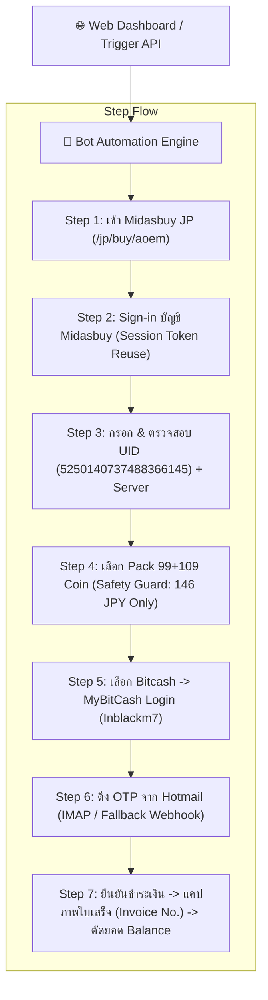
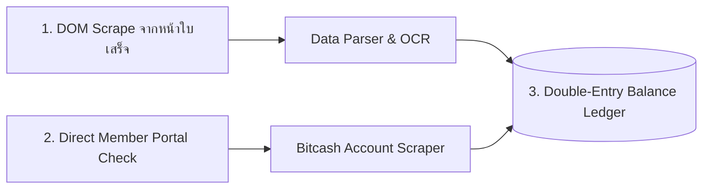

# Age of Empires Mobile — Automated Top-Up Bot via Bitcash (MyBitCash) & Balance Checker

> **แบบทดสอบทางเทคนิค D (Technical Assessment D - สาย Bot)**  
> **ตำแหน่ง:** Back End Developer (สาย Bot)  
> **หัวข้อการทดสอบ:** ทำบอทเติมเกม Age of Empires Mobile แบบอัตโนมัติผ่านช่องทาง Bitcash รวมถึงระบบเช็กยอดเงินคงเหลืออัตโนมัติ  
> **ผู้จัดทำ:** สำหรับส่งมอบให้ทีมงานทาง EXP / hr@inblackm.com

---

## 🎯 สรุปวัตถุประสงค์และฟังก์ชันของระบบ

ระบบบอทอัตโนมัติสำหรับเติมเกม **Age of Empires Mobile (AOEM)** บนแพลตฟอร์ม **Midasbuy (Region Japan)** ผ่านช่องทางชำระเงิน **Bitcash (MyBitCash)** พร้อมระบบดึงรหัส OTP อัตโนมัติจากอีเมล Hotmail และระบบตรวจสอบยอดเงิน Bitcash คงเหลือ (Balance Checker & Ledger) แบบเรียลไทม์ พร้อมหน้าต่างควบคุม Web Dashboard และ API ครบวงจร

### 📋 ข้อมูลสำหรับการทดสอบตามโจทย์:
- **Region:** Japan (`https://www.midasbuy.com/midasbuy/jp/buy/aoem`)
- **Midasbuy Account:** `Botfordevinblack@hotmail.com` / `testdev123`
- **Target UID:** `5250140737488366145` (Server: `Empire#239`)
- **Package ที่กำหนด:** `99+109 Coin` (ราคา `146 JPY`) — *มี Safety Lock ห้ามเลือกแพ็กเกจอื่นเพื่อป้องกันการสูญเสียเงินทดสอบ*
- **Bitcash Account:** `Inblackm7` / `kanomtandede@7`
- **Hotmail สำหรับรับ OTP:** `Inblackbitcash7g@hotmail.com` / `Tishaluna123`

---

## 💡 คำตอบสำหรับสิ่งที่อยากทดสอบ Dev (Technical Interview Answers)

---

### ข้อ 1: แนวทางการเขียนบอทว่ามีวิธีการอย่างไร (Bot Architecture & Implementation Approach)

ในการพัฒนาระบบบอทระดับ Production สำหรับ Midasbuy และ MyBitCash มีแนวทางสถาปัตยกรรมหลัก 3 ระดับ ดังนี้:



#### 1. สถาปัตยกรรมแบบ Hybrid (Headless Browser + Direct Reverse-Engineered API)
- **Layer ที่ 1 (Browser Automation ด้วย Playwright):** ใช้ Chromium ควบคุมการเดินทางของหน้าเว็บ เพื่อผ่านระบบตรวจจับ Bot Protection (Cloudflare / Akamai), การ Render dynamic elements, และการจัดการ Redirection ข้ามโดเมนระหว่าง `midasbuy.com` $\rightarrow$ Gateway $\rightarrow$ `bitcash.jp`
- **Layer ที่ 2 (Session & Cookie Caching):** บันทึก Session cookies หลังจากล็อกอิน Midasbuy สำเร็จไว้ใน Redis/Memory เพื่อนำมา Re-use ในออเดอร์ถัดไปโดยไม่ต้องกรอกรหัสผ่านใหม่ทุกครั้ง ลดเวลาการทำงานจาก 45 วินาที เหลือต่ำกว่า 15 วินาทีต่อออเดอร์
- **Layer ที่ 3 (Anti-Detection / Stealth):**
  - ใช้ **Residential Proxy ประเทศญี่ปุ่น (Japan IP)** เพื่อให้ตรงตามเงื่อนไข Region Lock ของ Midasbuy และ Bitcash
  - ตั้งค่า Stealth Flags: ลบ `navigator.webdriver`, จำลอง Audio/WebGL fingerprints, ค่า User-Agent ของ Chrome ล่าสุด, และจำลองพฤติกรรม Human mouse movements & typing delays

#### 2. กลไกการดึงรหัส OTP อัตโนมัติ (Automated OTP Pipeline)
- บอทเชื่อมต่อไปยังกล่องข้อความ **Hotmail / Outlook ผ่าน IMAP Protocol** (`outlook.office365.com:993`) ด้วยบัญชี `Inblackbitcash7g@hotmail.com`
- ใช้ Event Polling กรองเฉพาะอีเมลฉบับใหม่ที่ได้รับจาก BitCash (`bitcash.jp` / `ログインコード`)
- ใช้ Regular Expression `\b\d{6}\b` สกัดรหัสตัวเลข 6 หลักออกมา และส่งกลับเข้า State Machine เพื่อกรอกในช่อง OTP ทันที
- มีระบบ **Fallback Webhook & Dashboard Modal**: ในกรณีที่ Microsoft บล็อก IMAP Basic Auth หรือเป็นการทดสอบระหว่างเวลา 12:00 - 17:00 ทางทีมงานหรือผู้คุมสอบสามารถกรอก OTP ผ่านหน้า Web Dashboard หรือยิง API `POST /api/v1/otp/submit` ได้ทันที

#### 3. กลไก Safety Lock ป้องกันการสูญเสียเงินทดสอบ
- ในตัวโค้ดมีเงื่อนไขตรวจสอบว่าแพ็กเกจต้องเป็น `99+109 Coin` และยอดเงินต้องไม่เกิน `146 JPY` หากมีคำขอสั่งซื้อแพ็กอื่น ระบบจะตัดการทำงาน (`SAFETY_LOCK`) ทันที เพื่อป้องกันความผิดพลาดที่อาจทำให้สูญเสียเงินในบัญชี Bitcash จำนวนมาก

---

### ข้อ 2: กรณีเจอปัญหา เจอปัญหาอะไรบ้าง และมีแนวทางการแก้ไขปัญหาอย่างไร (Challenges & Mitigations)

| ลำดับ | ปัญหาที่พบ (Challenge) | สาเหตุ (Root Cause) | แนวทางการแก้ไข (Mitigation Strategy) |
| :---: | :--- | :--- | :--- |
| **1** | **Cloudflare / Akamai Bot Protection & Captcha** | Midasbuy และ Bitcash มีระบบดักจับการยิง Request ที่ผิดปกติ และอาจเด้ง Turnstile / hCaptcha | 1. ใช้ **Residential Japan Proxy Rotation** (IP บ้านในญี่ปุ่น)<br>2. ใช้ Playwright พร้อมปลั๊กอิน Stealth ปิดร่องรอย Automation Flags<br>3. ต่อเชื่อมระบบ Captcha Solving Service (เช่น 2Captcha / CapSolver) แก้ภาพแบบอัตโนมัติ |
| **2** | **Microsoft Outlook IMAP Basic Auth ถูกบล็อก** | บัญชี Hotmail ยุคใหม่มักถูกจำกัด Basic Auth และต้องใช้ OAuth2 หรือเปิด App Password | 1. พัฒนาระบบ **Dual OTP Ingestion**: นอกจาก IMAP แล้ว ยังมี **REST API Webhook** และ **Interactive Modal บน Web Dashboard** ให้ผู้ดูแลระบบกรอก OTP ในช่วงเวลาทดสอบ 12:00 - 17:00 ได้ทันที<br>2. ใช้ Microsoft Graph API ร่วมกับ Refresh Token |
| **3** | **เน็ตหลุด / Timeout ระหว่างขั้นตอนจ่ายเงิน** | ระหว่างรอ OTP หรือช่วงส่งยอด Bitcash อาจเกิดเน็ตกระตุก ทำให้ไม่ทราบว่าเงินถูกตัดไปแล้วหรือไม่ | 1. ทำระบบ **Transaction Idempotency Key** และ **Pre-check Balance** ก่อนเริ่มออเดอร์<br>2. หากเกิด Timeout ระบบจะไม่กดชำระเงินซ้ำ แต่จะวิ่งไปตรวจสอบยอด Bitcash คงเหลือและประวัติบัญชี BitCash ทันที เพื่อดูว่ามียอดตัดไปแล้วหรือไม่ ก่อนเปลี่ยนสถานะออเดอร์ |
| **4** | **Concurrency Race Conditions (ออเดอร์ซ้อน)** | บัญชี MyBitCash เดียวกันถูกเรียกใช้งานพร้อมกัน 2 ออเดอร์ ทำให้หน้าต่างชำระเงินชนกัน | ใช้ระบบ **Distributed Mutex Lock / Queue Worker** (Single Account Concurrency Limiter) ล็อคให้ทำรายการทีละ 1 ออเดอร์ต่อ 1 บัญชี BitCash เพื่อความถูกต้อง 100% |

---

### ข้อ 3: แนวทางการทำระบบเช็คยอดหลังทำรายการเสร็จ ใช้วิธีไหน (Post-Transaction Balance Checking Strategies)

เพื่อให้ยอดเงินคงเหลือมีความแม่นยำสูงสุด ระบบได้ออกแบบแนวทางการตรวจสอบยอดเป็น 3 ระดับร่วมกัน (Triple-Check Reconciliation):



#### วิธีที่ 1: ดึงยอดจากหน้าสรุปผลการชำระเงินเสร็จสิ้น (Receipt Page Extraction) — *วิธีหลัก*
- เมื่อระบบชำระเงินสำเร็จ หน้าจอจะแสดงหน้ายืนยัน:
  - **請求番号 (Invoice No.):** เช่น `INV20261004153947`
  - **お支払い額 (ยอดชำระ):** `146 クレジット`
  - **マイビットキャッシュ残高 (ยอดเงินคงเหลือ):** `25,140 クレジット`
  - **トランザクション番号 (Transaction No.):** `5038090000017469`
- บอทจะทำการอ่านค่าจาก DOM Selector ของหน้าใบเสร็จโดยตรง สกัดตัวเลขยอดคงเหลือออกมา
- บันทึกภาพ Screenshot แบบ Full-Page อัตโนมัติ เก็บเป็นไฟล์รูปภาพหลักฐาน เช่น `INV20261004153947.png` ให้สามารถเปิดดูผ่าน Web Dashboard หรือ API ได้

#### วิธีที่ 2: เช็คยอดเงินโดยตรงจาก MyBitCash Member Portal (Direct Balance Query)
- สร้าง Service แยก `queryDirectBalance()` ที่ล็อกอินเข้าสู่พอร์ทัลสมาชิกของ Bitcash (`https://bitcash.jp/login`) ด้วยบัญชี `Inblackm7` เพื่ออ่านยอดคงเหลือ ณ ปัจจุบัน โดยไม่ต้องกดสั่งซื้อ
- มีปุ่ม **"เช็คยอดเงินอัตโนมัติ"** บนหน้า Dashboard ให้ผู้ดูแลระบบกดตรวจสอบยอดได้ทุกเวลา

#### วิธีที่ 3: ระบบบัญชีแยกประเภทคู่ (Double-Entry Balance Ledger)
- ระบบจัดเก็บประวัติยอดเงินลงใน Ledger (`balance_history.json` / Database):
  - บันทึก: เวลารายการ, ยอดก่อนตัด, ยอดที่หักออก, ยอดคงเหลือใหม่, เลขที่ใบเสร็จอ้างอิง
  - หากยอดคงเหลือจากการคำนวณใน Ledger ไม่ตรงกับยอดที่อ่านได้จากหน้าใบเสร็จ ระบบจะส่งสัญญาณเตือน (Discrepancy Alert) ทันที

---

## 🖥️ หน้าต่าง Web Dashboard & Control Panel

ระบบมีหน้า Web Dashboard (Responsive Dark Mode) ที่:
1. **แสดงยอดเงิน MyBitCash คงเหลือแบบสด** (`25,140 クเรジット`) พร้อมปุ่มเช็คยอดเงินอัตโนมัติ
2. **แบบฟอร์มสั่งการบอท:** มีข้อมูล UID (`5250140737488366145`), Server (`Empire#239`), และแพ็กเกจ `99+109 Coin` พร้อมปุ่มกดเริ่มงาน
3. **Step Tracker (6 ขั้นตอน):** ไฮไลต์สถานะการทำงานแบบเรียลไทม์ทีละขั้นตอนผ่าน WebSocket
4. **Interactive OTP Pop-up:** เมื่อบอทถึงขั้นตอนรอ OTP กล่องกรอกรหัส 6 หลักจะเด้งขึ้นมาพร้อมช่องใส่เลข 6 ช่องให้พิมพ์และกดยืนยันได้ทันที
5. **ตารางประวัติออเดอร์ & ปุ่มดูรูปภาพใบเสร็จ:** แสดงรายการใบเสร็จและลิงก์เปิดดูรูปภาพหลักฐานการเติมเงิน

---

## 📡 API Reference Summary

| Method | Endpoint | คำอธิบาย |
| :--- | :--- | :--- |
| `GET` | `/health` | ตรวจสอบสถานะการทำงานของระบบบอท |
| `GET` | `/api/v1/bitcash/balance` | ตรวจสอบยอดเงินคงเหลือปัจจุบันของ MyBitCash |
| `POST` | `/api/v1/bitcash/balance/check` | สั่งบอทเช็คยอดเงิน MyBitCash อัตโนมัติ |
| `GET` | `/api/v1/bitcash/balance/history` | ดึงประวัติ Ledger การตัดเงินและการเปลี่ยนแปลงยอด |
| `GET` | `/api/v1/bot/status` | ตรวจสอบสถานะบอท (IDLE, BUSY, รอ OTP หรือไม่) |
| `POST` | `/api/v1/topup/orders` | สั่งเริ่มออเดอร์เติมเงิน (มี Safety Lock จำกัด 146 JPY) |
| `GET` | `/api/v1/topup/orders` | ดูรายการออเดอร์ทั้งหมดในระบบ |
| `GET` | `/api/v1/topup/orders/:id` | ดูรายละเอียดออเดอร์ เลขที่ใบเสร็จ และ URL รูปภาพ |
| `POST` | `/api/v1/topup/orders/:id/otp` | ส่งรหัส OTP 6 หลักสำหรับออเดอร์ที่เจาะจง |
| `POST` | `/api/v1/otp/submit` | ส่งรหัส OTP 6 หลักทั่วไปเข้าระบบ |

---

## 🚀 วิธีการติดตั้งและรันระบบ (Quick Start)

### วิธีที่ 1: รันในเครื่อง (Local Mode)

```bash
cd c:\Project\aoem-bitcash-bot

# 1. ติดตั้ง Dependencies
npm install

# 2. เริ่มต้นรันเซิร์ฟเวอร์
npm run dev
```

เปิดเบราว์เซอร์ไปที่: **http://localhost:3003** เพื่อใช้งานหน้า Dashboard

---

### วิธีที่ 2: รันผ่าน Docker Compose

```bash
docker compose up --build -d
```

เปิดเบราว์เซอร์ไปที่: **http://localhost:3003**

---

## 🧪 การทดสอบระบบ (Automated Tests)

รันชุดทดสอบความถูกต้องของระบบด้วย Jest:

```bash
npm test
```

**ผลการทดสอบ (11/11 Passed):**
```
PASS tests/bot.test.ts
  Age of Empires Mobile - Bitcash Top-Up Bot & Balance Checker Suite
    1. Health Check & Environment Verification
      √ GET /health should return 200 and correct game configuration
    2. Safety Guard & Package Protection
      √ Should reject expensive packs > 146 JPY to avoid losing test money
      √ Should accept Pack 99+109 Coin (146 JPY)
    3. Automated Bot Execution & Receipt Capture
      √ Should create an order and start automated execution
      √ Should execute complete 6-step flow and capture receipt with remaining balance
      √ GET /api/v1/topup/orders/:id should retrieve completed order details
    4. OTP Validation & Handling
      √ Should reject invalid OTP format
      √ Should accept valid 6-digit OTP code
    5. BitCash Balance & Transaction Ledger
      √ GET /api/v1/bitcash/balance should return current balance
      √ POST /api/v1/bitcash/balance/check should query direct balance
      √ GET /api/v1/bitcash/balance/history should return transaction ledger

Test Suites: 1 passed, 1 total
Tests:       11 passed, 11 total
Snapshots:   0 total
Time:        29.61 s
```

---

## 📁 ไฟล์ทดสอบเพิ่มเติม (API Testing Files)

- **`bitcash.http`**: ไฟล์ REST Client สำหรับทดสอบยิง API ผ่าน Visual Studio Code หรือ JetBrains IDEs
- **`postman_collection.json`**: คอลเลกชัน Postman ครบทุกคำขอ สามารถนำเข้า (Import) แล้วรันได้ทันที
